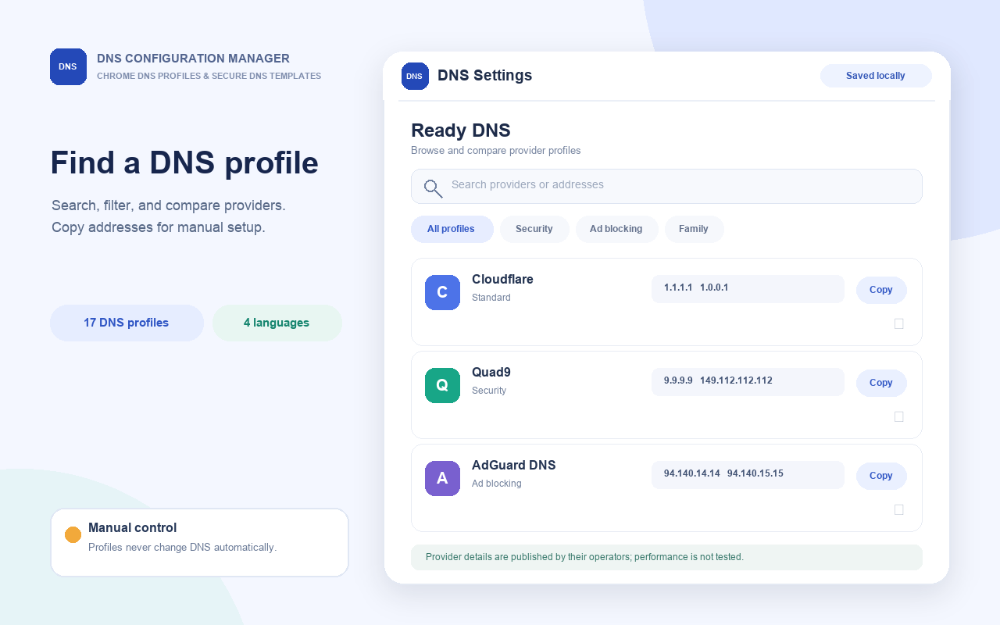
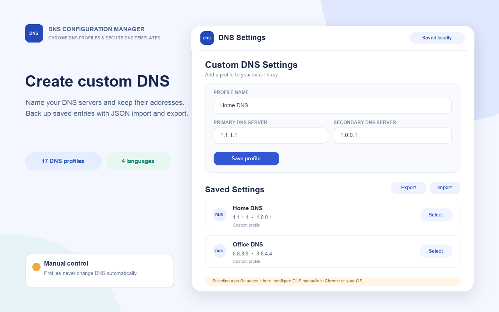
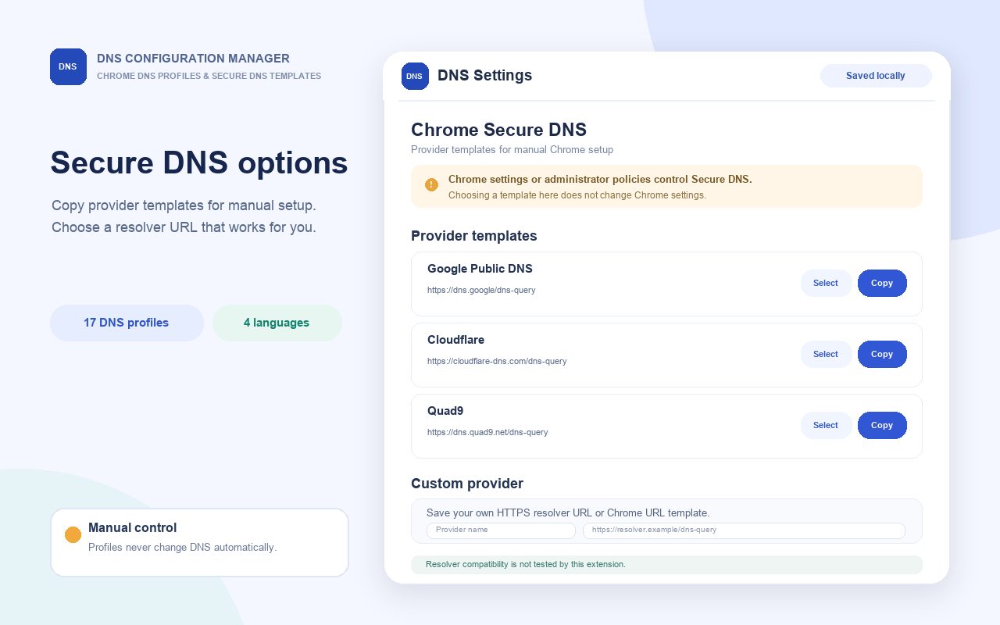

# DNS Configuration Manager

<p align="center">
  
</p>

A Manifest V3 Chrome extension for browsing DNS provider options, saving DNS profiles, and keeping DoH provider templates together for manual setup.

[Project website](https://sadrmanesh.github.io/chrome-dns-manager/) · [GitHub repository](https://github.com/sadrmanesh/chrome-dns-manager)

> **Important:** Selecting or saving a profile does not change DNS in Chrome or your operating system. The extension can copy profile details and open Chrome's Secure DNS settings; you must make and save any DNS changes yourself. It does not test resolver connectivity or performance.

## Features

- Browse built-in DNS profiles and DoH templates, or create your own.
- Search and filter providers, save favorites, and compare up to three profiles.
- Copy DNS addresses or DoH templates for manual configuration.
- Import and export custom profiles as local JSON files.
- Choose system, light, or dark appearance.
- Use the interface in English, Persian, Arabic, or Chinese.
- View browser-provided network estimates when supported. These are not active measurements.

## Interface previews

These illustrative interface mockups are design previews, not screenshots captured from a running browser or extension.

| Browse DNS profiles | Save custom profiles | Secure DNS templates |
|:--:|:--:|:--:|
|  |  |  |
| Search and compare provider profiles, then copy addresses for manual setup. | Save profiles locally and import or export JSON backups. | Review and copy resolver templates for manual Chrome Secure DNS setup. |

## Install

### Load the extension in Chrome

1. Download or clone this repository.
2. Open `chrome://extensions` in Chrome and enable **Developer mode**.
3. Select **Load unpacked** and choose the directory containing this README and `manifest.json`.

This repository does not currently provide a Chrome Web Store installation link.

### Configure DNS manually

Use the extension to review and copy DNS server addresses or DoH templates. To configure Chrome Secure DNS, open Chrome's security settings from the extension and follow the instructions there. For traditional DNS, use your operating system's network settings. Availability and behavior depend on Chrome, the operating system, and administrator policies.

## Privacy and permissions

The extension requests only Chrome's `storage` permission to save profiles and preferences locally. It does not request host or proxy permissions, send profile data to a project server, query DNS resolvers, or perform speed tests. Provider websites and DoH URLs shown in the extension are reference information; the extension does not contact them.

See [SECURITY.md](SECURITY.md) and the in-extension privacy policy for details.

## Development

No build step or third-party dependencies are required. To check JavaScript syntax with Node.js:

```sh
npm run lint
```

To try local changes, load this directory as an unpacked extension in Chrome and exercise the relevant flows. There is no automated browser test suite.

## Contributing

Bug reports and focused contributions are welcome. Read [CONTRIBUTING.md](CONTRIBUTING.md) before opening an issue or pull request.

## License

This project uses a custom non-commercial attribution license, not a standard open-source license. Read [LICENSE](LICENSE) before using, modifying, or redistributing the project. Commercial use requires the author's prior written permission.
